# 芯梭

芯梭是一款 Android SIM/eSIM 管理与通信应用，支持通过 USB/OTG 连接读卡器或通信模块，使用兼容的 SIM 卡打电话、收发短信，并管理 eSIM。在系统允许的机型上，也可通过授权有限使用手机内置的 SIM/eSIM，无需外接读卡器。“芯”对应 SIM/eSIM，“梭”寓意连接卡、设备与网络，让通信往来穿梭。

[下载最新 APK](https://github.com/ZCShou/uicclink/releases/latest) · [查看全部版本](https://github.com/ZCShou/uicclink/releases) · [问题反馈](https://github.com/ZCShou/uicclink/issues)

## 1. 功能

芯梭围绕“接入卡片、管理卡片、使用卡片通信”组织功能。实际可用能力取决于手机权限、外接设备、SIM/eSIM、运营商与网络支持情况。

界面图中的联系人、号码、短信、任务与卡片资料均为虚构内容，用于展示功能与布局。

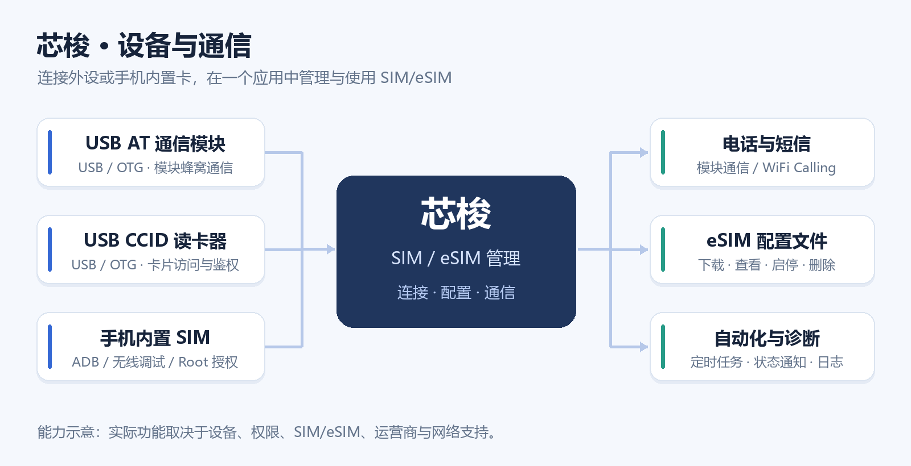

AT 通信模块可提供自己的蜂窝通信通道；CCID 读卡器提供卡片访问，通话和短信还需使用兼容的 WiFi Calling 服务。读卡器本身不提供蜂窝射频能力。

### 1.1 USB 设备接入

通过 USB-C 接口或 USB-A 转接头/OTG 线，将兼容的读卡器或通信模块连接到手机，在芯梭中授权并选择设备与卡片。

- 支持通过 OTG 接入标准 USB CCID（PC/SC）读卡器及兼容的 AT 通信模块。
- 查看卡片身份、设备信息、网络状态及通信参数，按卡片配置和使用通信能力。

下图展示 USB-C / USB 接口智能卡读写器的外观。使用这类外设时，需要确认其 CCID 协议、卡片电压及 APDU 交换能力与应用兼容。

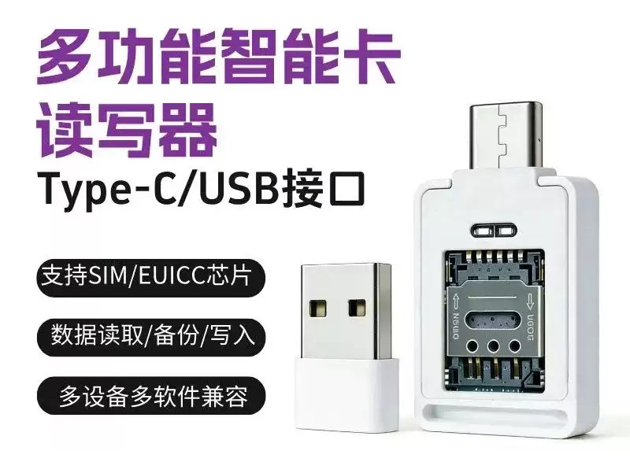

读卡器与通信模块承担的角色不同，选择设备时应先确认需要使用的通信方式。

| 接入设备 | 主要用途 | 电话与短信的通信通道 |
| --- | --- | --- |
| USB CCID 读卡器 + SIM/eUICC 卡 | 读取卡片、卡片鉴权及兼容的 eSIM 管理 | 需配合支持的 WiFi Calling 服务 |
| USB AT 通信模块 + SIM 卡 | 模块状态、网络注册、拨号及短信 | 模块自身的蜂窝网络与语音能力 |

设备页集中展示所选卡片的身份信息、网络能力、连接步骤和运行状态，也可在不同设备与卡槽之间选择通信卡。

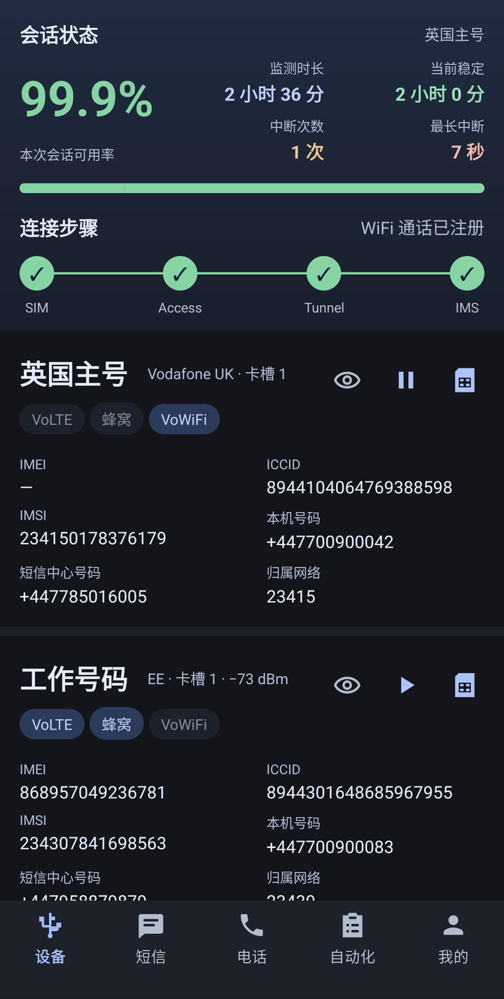

### 1.2 手机内置 SIM 授权接入

在支持的手机和系统上，可在“我的 → 设备接入”中授予电话读取权限，再通过 ADB、无线调试或已有 Root 权限中的一种方式，完成应用范围内的 SIM 身份读取与鉴权授权。这条路径可使用手机中已启用的物理 SIM 和 eSIM，不需要额外连接 USB 读卡器。

- 电话读取权限用于发现已启用的卡片；身份读取与鉴权还需要额外授权。
- 系统允许时，可读取 ICCID、IMSI、归属网络和可用的号码信息，并使用 SIM 鉴权接口建立兼容的 WiFi Calling 连接。
- ADB、无线调试与 Root 是不同的授权途径，授权能否生效、身份能否读取及鉴权能否成功，仍取决于系统实现、机型与运营商。

该接入方式的支持范围有限：身份读取与鉴权授权不提供任意原始 APDU 访问，也不等于获得完整的内置 eSIM 管理权限。部分内置 eSIM 操作需要进入系统管理页面；系统限制的能力不会因完成这项授权自动开放。

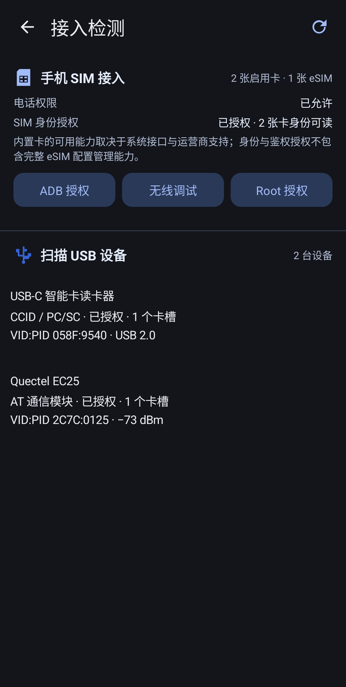

### 1.3 eSIM 管理

对兼容的 eUICC 设备，芯梭提供配置文件查看与管理，并支持通过激活码、二维码和选取的图片或 PDF 导入下载信息。

- 下载 eSIM 配置文件，查看已有配置文件及其状态。
- 在设备与权限允许时启用、停用和删除配置文件。
- 查看和处理 eSIM 通知；手机内置 eSIM 的部分操作需进入系统管理页面。

eSIM 的下载与管理围绕选定的目标卡片进行，操作前应确认设备支持情况和授权范围。

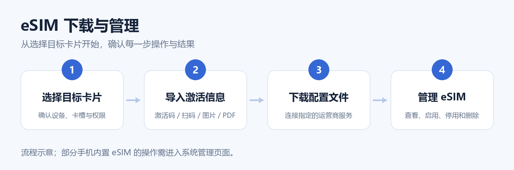

设备与卡片管理页面展示读卡器、目标 eUICC 及已有配置文件，包含运营商、ICCID、IMSI、号码与启用状态。外接 eUICC 与手机内置 eSIM 的可操作范围分别由设备协议和系统权限决定。

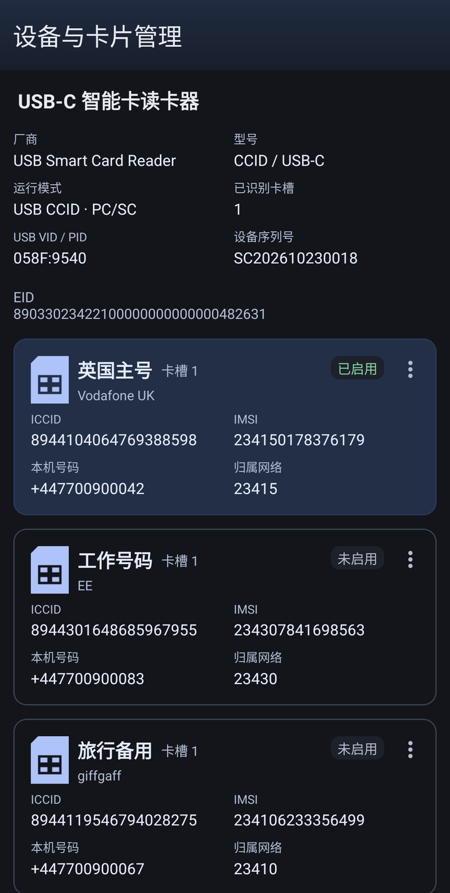

### 1.4 电话与短信

通过支持的通信模块，或在运营商支持的情况下使用 WiFi Calling，让所选通信卡参与电话和短信收发。

- WiFi Calling 连接、状态查看与连接诊断。
- 拨打、接听电话，查看通话记录。
- 收发短信、查看会话和收件记录，保留发送草稿。
- 管理联系人，并从联系人发起通话或短信。

电话页提供拨号键盘、联系人与通话记录，支持按所选通信卡发起通话。短信页按联系人或号码组织会话，并显示消息时间和收发状态。

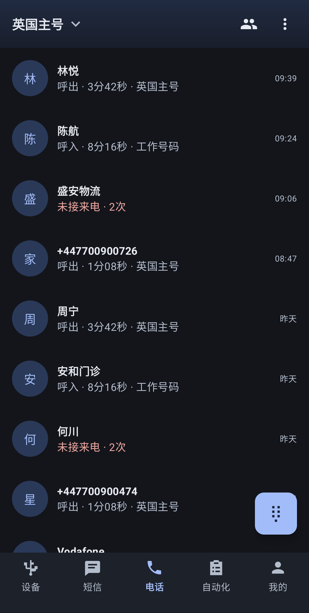 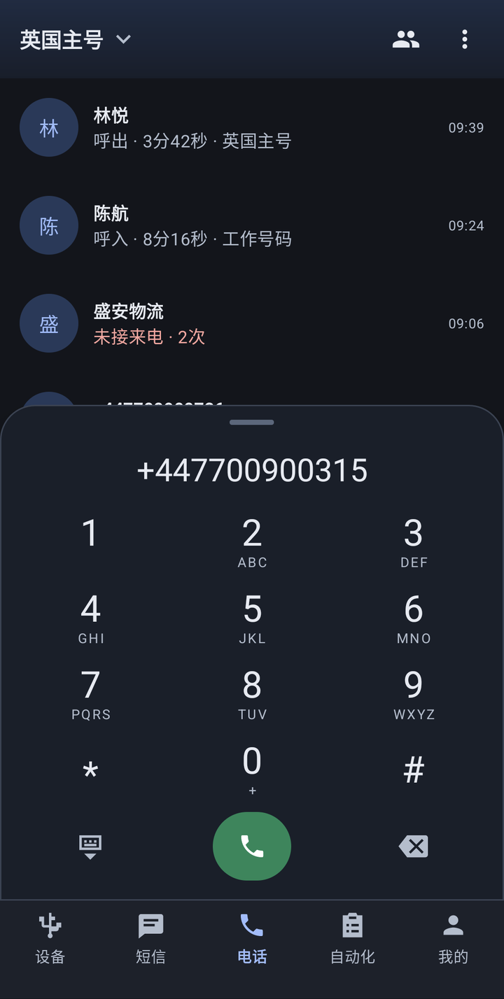

短信列表展示不同联系人的会话，打开后可以查看完整短信往来，并使用当前选定的通信卡继续发送。

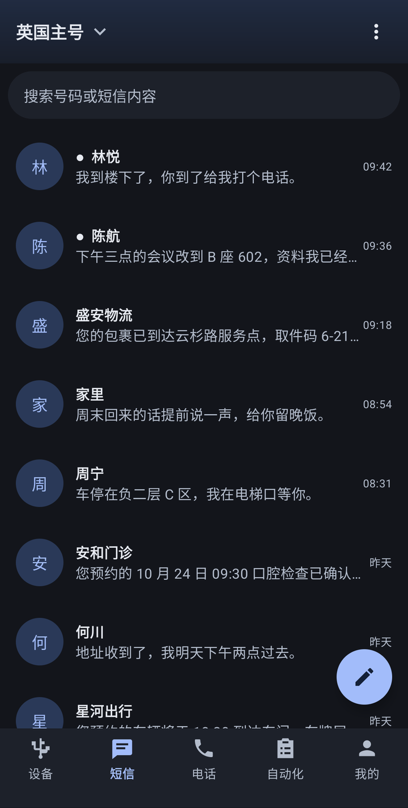 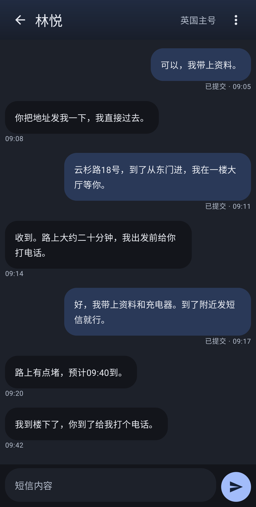

### 1.5 自动化与诊断

定时任务帮助处理重复操作，连接状态、通知与日志用于查看执行结果和定位设备接入问题。

- 定时发送短信、定时检查设备状态。
- 来电、短信与连接状态通知。
- 查看、复制和清理运行日志，按需开启诊断记录。

自动化页集中管理定时任务；诊断设置可控制日志记录和本地日志容量。

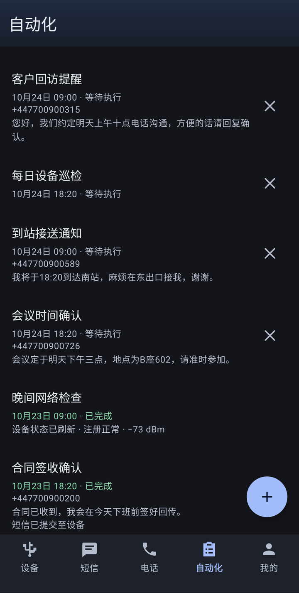 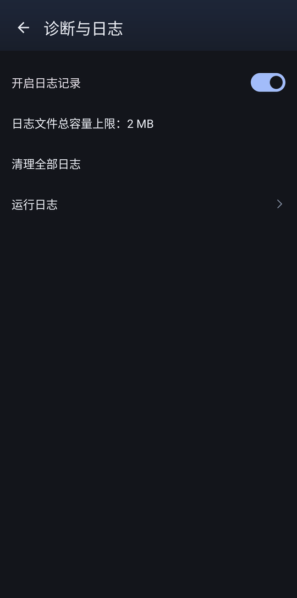

## 2. 下载与安装

APK 通过本仓库的 GitHub Releases 发布。下载前请检查版本说明中的系统要求与适配范围。

### 2.1 系统要求

当前发布包面向 Android 11 及以上系统，处理器架构为 ARM64（`arm64-v8a`）。使用 USB 设备时，手机还需支持 USB Host/OTG，并为外设提供足够供电。

### 2.2 安装与更新

打开[最新版本](https://github.com/ZCShou/uicclink/releases/latest)，在 Assets 中下载 APK，按 Android 提示允许当前下载应用安装未知来源应用，然后完成安装。正式版沿用原有包名与签名，可覆盖安装已有的正式版本。

每个版本同时提供 `SHA256SUMS.txt`，可用于核对下载文件的 SHA-256 摘要。请在发布页面的 Assets 中选择 APK 安装包。

安装后可在“我的 → 关于芯梭”查看当前版本、检查更新，并阅读用户协议与隐私政策。

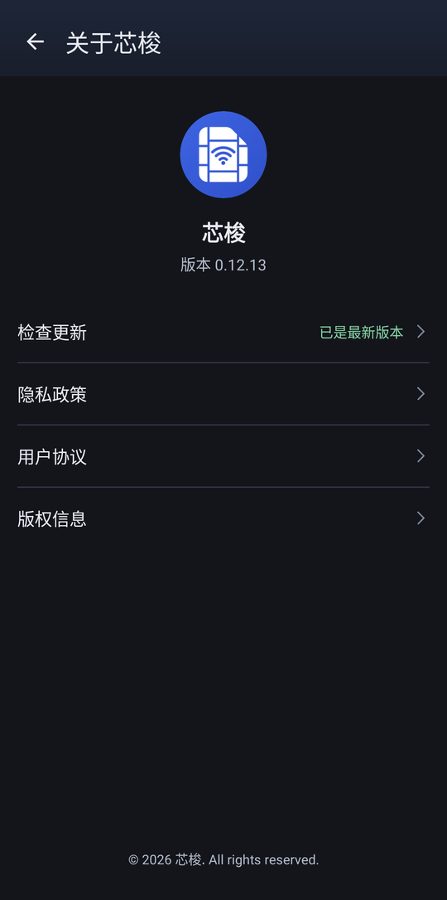

## 3. 使用条件

芯梭提供卡片管理与通信入口，具体服务仍依赖卡片、设备及运营商本身的能力。安装应用不会自动开通运营商服务或取得系统特权。

### 3.1 连接设备与卡片

外接读卡器或模块通过 OTG 连接后，在应用中授予 USB 访问权限并选择目标卡片。手机内置 SIM 的高级访问可能需要按应用指引通过 ADB、无线调试或 Root 授权；不同系统和机型的支持范围可能不同。

### 3.2 使用通信与任务

WiFi Calling 需要 SIM、运营商与当前网络支持相关服务。USB 模块拨号时，语音通道由模块自身能力决定。通话、短信及其他服务的资费按运营商规则计算，芯梭不提供手机号、套餐或免费通信额度。

定时任务执行期间需要保持对应设备连接，并允许应用后台服务和通知运行。浏览和读取功能不要求会员；通信及 eSIM 写操作需满足应用内显示的账号与会员条件。

### 3.3 管理 eSIM

下载前请准备有效的激活信息，并确认目标 eUICC 与操作权限。读卡器本身不等于 eSIM，应用也不会将普通 SIM 转换为 eUICC。启用、停用或删除会改变配置文件状态，操作结果不明时应先刷新核实。

## 4. 反馈

功能建议、使用问题和设备兼容性反馈可以通过 GitHub Issues 或应用内“帮助与反馈”提交，便于补充信息和跟进处理进展。

### 4.1 问题反馈

可通过[GitHub Issues](https://github.com/ZCShou/uicclink/issues)或应用内“帮助与反馈”提交问题。请提供应用版本、手机型号、Android 版本、外设型号和复现步骤；分享截图或日志前请遮盖手机号、ICCID、IMSI、EID、激活码和账号凭据。

### 4.2 设备兼容性反馈

反馈外设或运营商兼容性问题时，请注明读卡器或模块型号、连接方式、SIM 所属运营商、所在网络，以及设备识别、读卡、WiFi Calling、电话或短信在哪一步出现问题。分享 eSIM 下载问题时，请提供错误提示，勿公开完整激活码。
